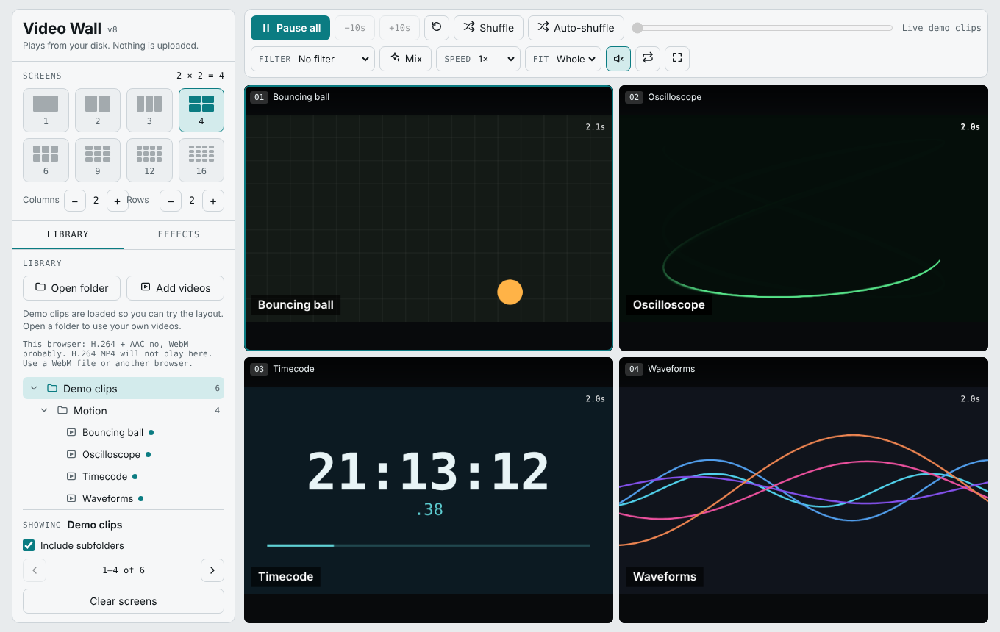
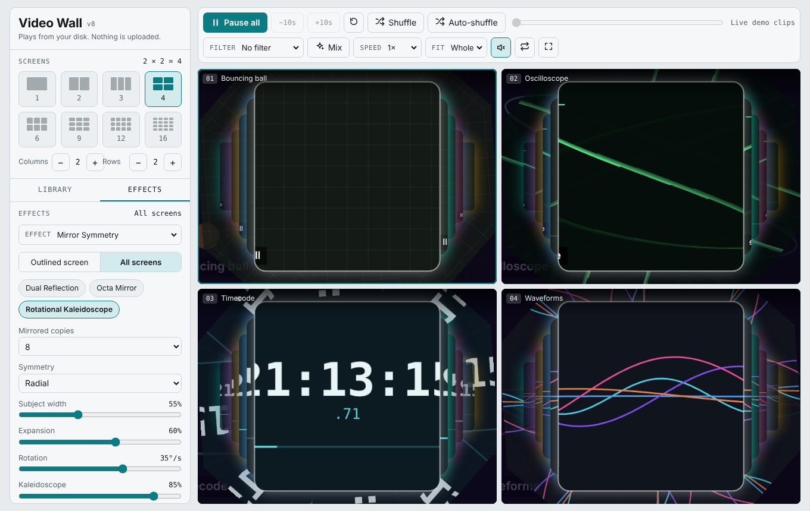
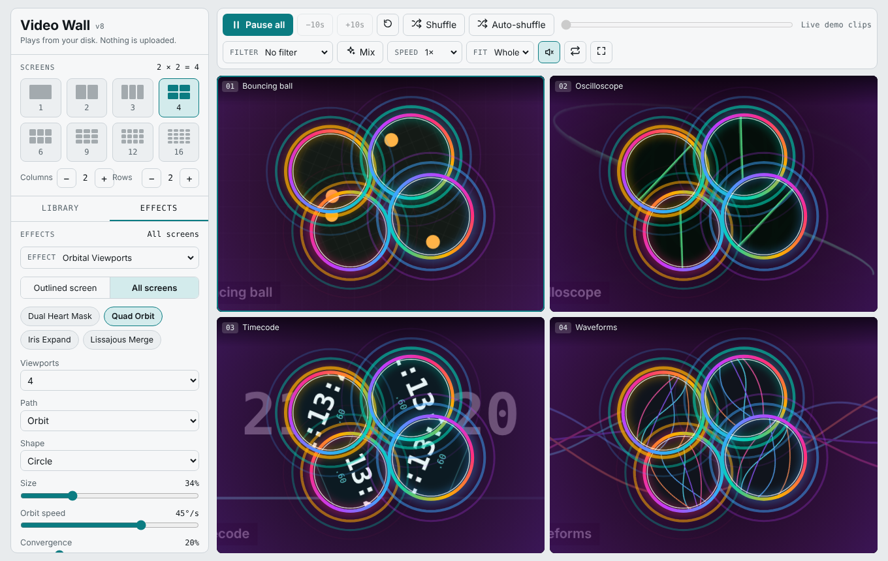
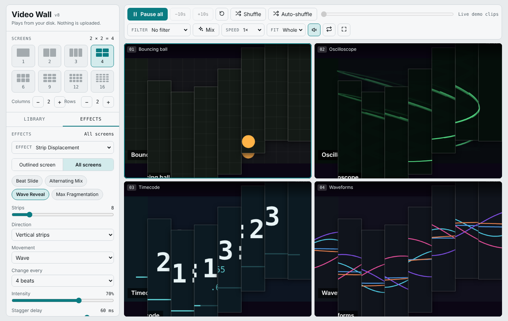

# Video Wall


Play many local videos side by side in your browser. Pick a folder, choose how many screens you want, and watch them on a grid. Add filters, shuffle videos at random, or run them through three beat-synced visual effects.

Everything runs in one HTML file. There is nothing to install, no build step, and no server. Your videos never leave your computer.



## Contents

- [Features](#features)
- [Quick start](#quick-start)
- [Using the app](#using-the-app)
- [Effects](#effects)
- [Beat sync](#beat-sync)
- [Filters](#filters)
- [Keyboard shortcuts](#keyboard-shortcuts)
- [Supported formats](#supported-formats)
- [Browser support](#browser-support)
- [Privacy](#privacy)
- [Troubleshooting](#troubleshooting)
- [Known limitations](#known-limitations)
- [Project structure](#project-structure)
- [Extending the app](#extending-the-app)
- [Roadmap](#roadmap)
- [Contributing](#contributing)
- [License](#license)

## Features

**Screens and layout**
- Grid of 1 to 30 screens: presets for 1, 2, 3, 4, 6, 9, 12 and 16, or set columns (1 to 6) and rows (1 to 5) yourself.
- Click a screen to select it, double-click to enlarge it, and press Esc to go back to the grid.
- Fit mode: show each video whole, or fill the screen and crop the edges.

**Library**
- Open a whole folder, including subfolders, and browse it as an expandable tree.
- Click a folder to fill the screens with its videos. Turn "Include subfolders" on or off, and page through large folders with the previous and next buttons.
- Click a single video to put it on the selected screen, or drag it onto any screen.
- Drag video files from your computer straight onto a screen.

**Playback**
- Play or pause every screen together, jump back or forward 10 seconds, and restart.
- One seek slider moves all videos to the same point in their timelines.
- Speed from 0.5x to 2x, loop, mute all, and fullscreen.
- Each screen also has its own play, mute, enlarge and clear buttons.

**Random play**
- **Shuffle** puts a different random video on every screen. It uses each video once before repeating any.
- **Auto-shuffle** replaces a video with a new random one on its screen whenever it finishes.

**Same video on every screen**
- **Same video** (key `D`) copies the outlined screen's video to all screens. Choose **In sync**, or start each screen a few seconds later than the one before (+1, +3, +5 or +10 s), which gives a canon or echo effect.

**Filters**
- 18 per-screen looks, applied to one screen or all of them, plus a **Mix** button that gives every screen a different random filter.

**Effects**
- Three beat-synced, Canvas 2D effects with adjustable parameters and ready-made presets: [Mirror Symmetry](#mirror-symmetry), [Orbital Viewports](#orbital-viewports) and [Strip Displacement](#strip-displacement).

**Try it without any files**
- The page opens with six generated demo clips (test patterns and moving graphics), so you can try the layout, filters and effects before opening your own videos.

## Quick start

**Option 1: open the file**

1. Download `index.html` (or clone this repository).
2. Open it in Chrome, Edge or another Chromium browser.
3. Click **Open folder** and choose a folder of videos.

**Option 2: GitHub Pages (a link you can open anywhere)**

1. In your repository, go to **Settings → Pages**.
2. Under **Build and deployment**, choose **Deploy from a branch**, then select your main branch and the `/ (root)` folder.
3. After a minute, the app is live at `https://<your-username>.github.io/<repository-name>/`.

Videos are still read from your own computer. Hosting only serves the page.

## Using the app

The left panel has two tabs.

**Screens and Library**
1. Choose a layout with the preset tiles, or use the **Columns** and **Rows** buttons.
2. Click **Open folder** to load a folder, or **Add videos** to pick individual files. You can open several folders. They all stay in the tree.
3. Click a folder to fill the screens, or click a video to place it on the outlined screen.

**Effects**
1. Open the **Effects** tab and choose an effect.
2. Choose whether it applies to the outlined screen or to all screens.
3. Pick a preset, then adjust any control. Changes apply as you move them.

The bar above the grid controls playback for all screens at once. Hover over a screen to show its own buttons and its filter menu.

## Effects

Each effect draws on a canvas laid over the screen, using the playing video as its source. Everything is plain 2D canvas. There is no WebGL and no machine-learning model, so effects run on almost any computer.

### Mirror Symmetry



Mirrored copies of the centre of the frame, with the original always drawn largest on top.

| Control | What it does |
|---|---|
| Mirrored copies | 2, 4 or 8 reflections |
| Symmetry | Horizontal, vertical, or radial (a ring around the centre) |
| Subject width | How much of the middle of the frame counts as the subject |
| Expansion | How far the copies spread from the original |
| Rotation | Spin speed of the radial ring and the kaleidoscope |
| Kaleidoscope | Blends in a wedge kaleidoscope behind everything |
| Beat zoom | How much the original pulses on each beat |
| Copy opacity | Brightness of the copies |
| Expansion motion | Still, breathing, or kicking outward on each beat |
| Auto-cycle symmetry | Every 8 beats, collapses to the centre, switches symmetry, and expands again |

Presets: **Dual Reflection**, **Octa Mirror**, **Rotational Kaleidoscope**.

### Orbital Viewports



One to four animated windows that orbit, grow, shrink, overlap and merge over a dimmed copy of the video.

| Control | What it does |
|---|---|
| Viewports | 1 to 4 windows |
| Path | Circular orbit or figure eight |
| Shape | Circle, heart, or a circle that morphs into a heart |
| Size, Orbit speed | Window size and travel speed (negative reverses direction) |
| Convergence | How far the windows drift together and merge |
| Beat scale | How much the windows swell on each beat |
| Time offset per viewport | Each window shows the video from a different point in time |
| Concentric rings, Border thickness, Glow | Ripple rings and the colourful border |
| Subject zoom, Content rotation | Crop into the middle of the frame and spin the picture inside each window |
| Backdrop dimming | How dark the background video is |
| Iris | Grow from a point to a large window and shrink back |

Presets: **Dual Heart Mask**, **Quad Orbit**, **Iris Expand**, **Lissajous Merge**.

### Strip Displacement



The video is cut into strips that slide, scatter, rotate and reassemble. A different moment of the same video shows through the gaps.

| Control | What it does |
|---|---|
| Strips | 4 to 30 |
| Direction | Horizontal strips, vertical strips, or alternating between them |
| Movement | Slide, scatter, rotate, wave, or a mix of all four |
| Change every | Every 1, 2, 4 or 8 beats |
| Intensity | How far strips move |
| Stagger delay | Delay between neighbouring strips, which makes ripples |
| Reveal time offset | Which moment shows through the gaps, in seconds before or after the playhead |
| Spring stiffness | Higher values snap into place faster |

Presets: **Beat Slide**, **Alternating Mix**, **Wave Reveal**, **Max Fragmentation**.

Effects work together with filters, layouts, shuffle and the playback bar.

## Beat sync

Effects move on the beat. The **Beat** section at the bottom of the Effects tab controls where the beat comes from.

- **Music (auto-detect):** the page listens to the low frequencies of the video's audio and triggers on each onset. It uses a hidden, silent copy of the video for this, so detection works even when the screen is muted.
- **Tempo clock:** a steady beat at the BPM you choose, from 60 to 200. Use **Tap tempo** to set it by tapping along.
- **Music sensitivity** adjusts how easily beats are detected.

If no usable audio is found, for example with the demo clips or a video whose audio the browser cannot decode, the page falls back to the tempo clock automatically. The status line under the beat controls tells you which one is in use.

## Filters

No filter, Black and white, Sepia, Vintage, Warm, Cool, Vivid, High contrast, Moody, Neon, Invert, X-ray, Night vision, Dreamy blur, Heavy blur, Color spin, Mirror and Upside down.

Use the **Filter** menu in the top bar to set all screens, the menu on each screen to set one, or **Mix** for a random filter on every screen. Filters also apply to screens that are running an effect.

## Keyboard shortcuts

| Key | Action |
|---|---|
| Space | Play or pause all screens |
| S | Shuffle all screens |
| D | Same video on all screens |
| Esc | Leave the enlarged view |
| Double-click a screen | Enlarge or restore it |

## Supported formats

What plays depends on your browser and operating system, not on this app.

| Format | Notes |
|---|---|
| MP4 (H.264 video, AAC audio) | Best choice, plays almost everywhere |
| WebM (VP8 or VP9, Opus or Vorbis) | Plays in all major browsers |
| MOV | Works when it contains H.264 |
| MKV, AVI | Sometimes work, often do not |
| H.265 / HEVC | Usually does not play in browsers |

## Browser support

- Developed and tested on Chromium-based browsers (Chrome, Edge, Brave).
- Firefox works when your system provides the video codecs, which is most often a problem on Linux and on Windows "N" editions.
- Safari has not been tested.

Everything needs a modern browser with `<video>`, Canvas 2D and the Web Audio API.

## Privacy

- Videos are read directly from your disk and played in the browser. Nothing is uploaded.
- The app does not use cookies, analytics or local storage.
- The only network request is to Google Fonts for the typefaces (Bricolage Grotesque, Instrument Sans and JetBrains Mono, all under the SIL Open Font License). If you are offline, the page uses system fonts instead.

## Troubleshooting

**The picture is black but I can hear the audio, or a screen says it cannot play the file.**
The browser cannot decode the video track. The screen shows a reason. The usual cause is H.265/HEVC video or 10-bit video. Re-encode it with [ffmpeg](https://ffmpeg.org/) or [HandBrake](https://handbrake.fr/):

```
ffmpeg -i input.mp4 -c:v libx264 -pix_fmt yuv420p -c:a aac output.mp4
```

If the video is already standard H.264 and only the audio is unusual (AC3 or DTS), keep the video and convert just the audio:

```
ffmpeg -i input.mp4 -c:v copy -c:a aac output.mp4
```

**The effects do not follow the music.**
The status line under the beat controls says "Tempo clock" when no audio is detected. Check that the video has a soundtrack the browser can decode, raise **Music sensitivity**, or choose the tempo clock and tap in the tempo.

**Playback is choppy with many screens.**
Every screen decodes its own video. Use fewer screens, smaller or lower-resolution files, and avoid heavy blur filters on large walls. Effects that show different moments of the same video (Orbital Viewports and Strip Displacement) use one extra hidden decoder for each extra moment.

**"Open folder" picks nothing on a phone.**
Mobile browsers do not support folder selection. Use **Add videos** instead.

## Known limitations

- Time offsets and beat detection need real video files. The built-in demo clips are live-generated graphics, so they play the same moment everywhere and use the tempo clock.
- The effects use the middle of the frame as the subject. There is no automatic detection of people. Use **Subject width** and **Subject zoom** to frame them.
- Beat detection looks for strong low-frequency hits. Music with soft or irregular beats may need a sensitivity change or the tempo clock.
- The page cannot remember your folders between visits, because browsers do not let a web page keep access to your files.

## Project structure

```
.
├── index.html     the entire app: markup, styles and script
├── docs/          screenshots used in this README
├── LICENSE
└── README.md
```

There is no build step and no package manager. Edit `index.html` and reload.

Inside `index.html` the script is organised in sections: demo clip generator, library tree, screens and layout, transport controls, filters, random play, the effects engine (beat detection, time-shifted frame sources, render loop), the three effect renderers, and the effects panel.

## Extending the app

To add a new effect:

1. Add an entry to the `FXDEF` object with its default values, the list of controls, and any presets.
2. Add a function to `RENDER` with the same key. It receives the screen, its settings, a 2D drawing context, the size, the current time and the beat state, and draws one frame.
3. Add an option for it to the effect menu in the markup.

The controls and preset buttons are generated from the `FXDEF` entry, so no extra interface code is needed. Use `getSrc(screen, slot, offsetSeconds)` when you want a frame from a different moment of the same video.

To add a filter, add an entry to the `FILTERS` list with a CSS `filter` string and an optional `transform`.

## Roadmap

Ideas, in no particular order:

- Installable app (PWA, or a desktop build with Electron or Tauri).
- Remember folders between sessions.
- Record the wall to a video file, and save screenshots.
- Per-viewport time offsets and more effect presets.
- Drag screens to rearrange them, and resizable cells.
- Search the library, thumbnails, and subtitle support.

## Contributing

Issues and pull requests are welcome. For code changes, please:

1. Keep the app a single file with no runtime dependencies.
2. Keep effects on Canvas 2D.
3. Test in at least one Chromium browser and describe what you tested.

## License

Released under the [MIT License](LICENSE). You can use, copy, modify and share it freely, including for commercial work, as long as the copyright and license notice stay with it.
